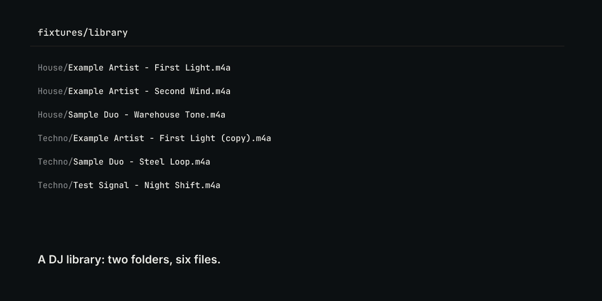
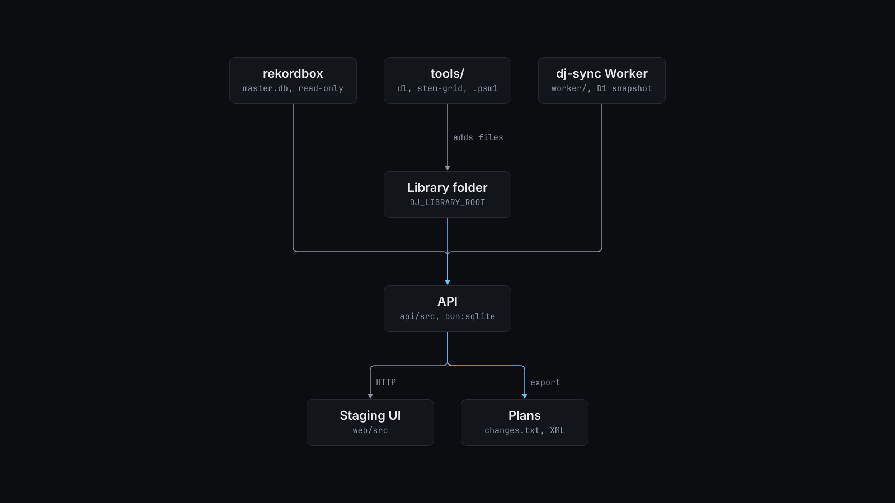

# dj-organizer

A local web app for DJs that scans a music folder, finds duplicate tracks, stages playlist changes and writes them out as plans you apply yourself, so your files and rekordbox library stay untouched until you decide.



## Why

A DJ library grows from many sources: downloads, rips, rekordbox imports and copies made while preparing sets. The same audio ends up in two folders under two names, and rekordbox and the folder on disk drift apart. Tools that fix this by moving or deleting files are risky on a library you play live from. dj-organizer keeps every change in its own SQLite database. Changes leave the app only as a text plan or a rekordbox XML file, or through one guarded apply script that backs up `master.db` first.

## Install

Requirements:

- [Bun](https://bun.sh) 1.3 or later (tested with 1.3.14).
- `curl`, used by `serve.sh` to wait for the server.
- Optional, for rekordbox features: Python 3 (tested with 3.12) with `pyrekordbox` and `sqlalchemy`, and rekordbox 6 or 7.
- Optional, for downloads and YouTube Music: `yt-dlp`, Node.js, and Python with `ytmusicapi`.
- Optional, for `tools/dl`: Rust (tested with cargo 1.94).
- Optional, for `tools/stem-grid`: Python 3 with `librosa`, `soundfile`, `scipy` and `numpy`, and the `rubberband` CLI.

```bash
bun install
bun run build    # builds the staging UI into web/dist
```

## Quick start

The repository ships a sample library in `fixtures/library`: six four-second sine-tone tracks in two folders, one of which is a byte-for-byte copy of another. `fixtures/make-library.sh` regenerates it with `ffmpeg`.

Start the server against the sample library:

```bash
DJ_LIBRARY_ROOT=$PWD/fixtures/library ./serve.sh start
```

```text
up   http://localhost:8765   (pid 73750)
```

`data/server.log` shows what the scan found:

```text
  dj-organizer  http://localhost:8765
  6 tracks · 0 playlists · 6 unfiled · 1 duplicates
```

Stage the duplicate for deletion, then read the changeset:

```bash
curl -s -X POST localhost:8765/api/duplicates/resolve
curl -s localhost:8765/api/changes.txt
```

```text
{"groups":1,"staged":1,"membershipsMerged":0,"skippedManual":0,"reclaim":34054}
# dj-organizer changeset
# generated 2026-11-04T15:51:47.951Z

## delete by hand (1) — this app moves nothing
  x Techno/Example Artist - First Light (copy).m4a   [duplicate]
```

The file is still on disk. Open http://localhost:8765 to do the same in the staging UI. Stop the server with `./serve.sh stop`.

## How it works



The API (`api/src`, Elysia on Bun) scans `DJ_LIBRARY_ROOT` and stores each track in `data/library.db` (`bun:sqlite`). A track's identity is an xxHash64 of its audio payload, so a renamed, moved or retagged file is still the same track. When there is no audio hash match, the API falls back to the source video id and then to a title and duration key. The duplicate finder (`dupes.ts`) groups tracks as `identical`, `source` or `twin`. It keeps one track per group and stages the rest.

rekordbox is a second store. The API reads `master.db` read-only and compares it with the folder on disk. Every playlist, membership and delete you make in the UI goes into an append-only operation log (`ops.ts`). The log replays as a plan per store:

- `GET /api/changes.txt` is the changeset against the latest rekordbox observation.
- `GET /api/plan/fs/text` is the filesystem plan.
- `GET /api/export/rekordbox.xml` is a rekordbox XML file that you import from rekordbox.

The **Apply** button (`POST /api/apply/rekordbox`) is the one path that writes to rekordbox. It closes rekordbox and runs `scripts/apply-rekordbox.py`. The script copies `master.db` to `DJ_BACKUP_DIR`, adds the pending tracks and playlist links, checks the result and reopens rekordbox. It calls `tasklist.exe` and `taskkill.exe`, so it works only on Windows or WSL.

Downloads (`download.ts`) are the only other writer. They call `yt-dlp --no-overwrites` and only add new files under the library folder. Snapshots of the staging database go to `data/snapshots/`.

The optional `worker/` is a Cloudflare Worker named dj-sync. A cron every 10 minutes refreshes your linked YouTube Music playlists into D1. `POST /api/ytm/pull` then reads one snapshot from the Worker instead of scraping YouTube from your machine. To deploy it, create the database with `wrangler d1 create dj-sync`, put its id into `worker/wrangler.jsonc`, load `worker/schema.sql`, and set the `SYNC_TOKEN` secret.

### Tools

`tools/` holds standalone command-line tools that the app does not call.

`tools/dl` is a Rust wrapper around `yt-dlp` for YouTube Music and SoundCloud audio:

```text
$ cargo build --release --manifest-path tools/dl/Cargo.toml
$ tools/dl/target/release/dl --help
usage:
  dl URL [OUT_DIR]          download best available audio
  dl -F URL                 list formats
  dl doctor                 show setup status

YouTube Music:
  uses PO-token provider + EJS + web_music client
  prefers 774/141/251/140/bestaudio
  reads cookies from %YTDLP_COOKIES% or %USERPROFILE%\yt-cookies.txt
$ tools/dl/target/release/dl doctor
yt-dlp: true
node: true
pot_provider_repo: false
pot_provider_port: false
cookies: not found (expected %YTDLP_COOKIES% or %USERPROFILE%\yt-cookies.txt)
```

For YouTube URLs, `dl` starts the [bgutil-ytdlp-pot-provider](https://github.com/Brainicism/bgutil-ytdlp-pot-provider) server from `~/bgutil-ytdlp-pot-provider` if nothing listens on port 4416. You install that provider yourself.

`tools/powershell/MusicDownload.psm1` gives Windows PowerShell the same downloads as short commands: `sc`, `scf`, `scy` and `sci` for SoundCloud, `ytm` and `ytmf` for YouTube Music, and `Start-YtPotProvider`. Add these lines to your profile:

```powershell
Remove-Item Alias:sc -Force -ErrorAction SilentlyContinue
Import-Module <path>\MusicDownload.psm1
```

The first line is needed because Windows PowerShell maps `sc` to `Set-Content`.

`tools/stem-grid/render_grid.py` takes four stems in the htdemucs layout (`vocals.wav`, `other.wav`, `drums.wav`, `bass.wav`) and a full mix. It builds one beat map from the drums and the mix, warps every stem through that map with `rubberband` to a target tempo, and checks the output for clicks at the joins and for a steady beat. On a synthetic 40 s, 66.7 BPM set of stems, `--bpm 150` gave four 17.79 s files with 45 output beats at a median 0.4005 s apart and 0 join clicks:

```bash
python3 tools/stem-grid/render_grid.py --mix mix.wav --stems stems --out out --bpm 150
```

The script never overwrites an existing `<stem>_final_<bpm>.wav`.

## Configuration

The server reads environment variables. Copy `config.example.env` to `.env` in the repository root. Bun loads `.env` at startup and the Python helpers inherit it. `serve.sh` also loads `data/sync.env` if it exists. Every value is optional.

| Variable | Default | What it does |
| --- | --- | --- |
| `DJ_LIBRARY_ROOT` | `~/Music/tracks` | The music folder the app scans and downloads into. |
| `DJ_REKORDBOX_DIR` | `~/AppData/Roaming/Pioneer/rekordbox` | rekordbox app data folder that holds `master.db` and `share/`. Under WSL, point it at the Windows profile. |
| `DJ_REKORDBOX_EXE` | `C:\Program Files\rekordbox\rekordbox 7.2.14\rekordbox.exe` | rekordbox executable that **Apply** reopens. |
| `DJ_DATA_DIR` | `./data` | App state: `library.db`, snapshots, art cache, `openrouter.json`. |
| `DJ_BACKUP_DIR` | `$DJ_DATA_DIR/backups` | Where `scripts/apply-rekordbox.py` copies `master.db` before it writes. |
| `DJ_YTDLP` | `yt-dlp` | The `yt-dlp` binary. |
| `DJ_NODE` | `node` | The Node.js binary that `yt-dlp` uses for YouTube's JavaScript challenge. |
| `DJ_YTM_COOKIES` | `$DJ_DATA_DIR/cookies/ytm-premium.txt` | Netscape cookie file exported from your own signed-in browser. |
| `DJ_YTM_SEED_PLAYLIST` | none | Id of a public playlist you own. The app discovers playlists on that playlist's channel. |
| `DJ_SYNC_URL` | none | URL of your deployed dj-sync Worker, for `POST /api/ytm/pull`. |
| `DJ_SYNC_TOKEN` | none | Bearer token. Use the same value as the Worker's `SYNC_TOKEN` secret. |
| `DJ_MANUAL_PLAYLISTS` | none | Comma-separated playlist names that you curate by hand. Dedupe never writes into them. |
| `DJ_SYNC_EXCLUDED_PLAYLISTS` | none | Comma-separated playlist names that sync never pulls or stages. |
| `DJ_AUTO_MEMBERSHIP_EXCLUDED_PLAYLISTS` | none | Comma-separated playlist names that never get automatic memberships. |
| `OPENROUTER_API_KEY` | none | Enables AI set suggestions. You can also save the key from the UI. |
| `PORT` | `8765` | Server port. |

`tools/dl` and `MusicDownload.psm1` read these variables:

| Variable | Default | What it does |
| --- | --- | --- |
| `YTDLP_COOKIES` | `yt-cookies.txt` in your home folder | Netscape cookie file for YouTube Music. |
| `SOUNDCLOUD_OAUTH_TOKEN` | none | Your SoundCloud OAuth token, for streams your account can play. |
| `SOUNDCLOUD_PROXY_URL` | none | Proxy for SoundCloud requests. |
| `BGUTIL_POT_PROVIDER_DIR` | `bgutil-ytdlp-pot-provider` in your home folder | Provider checkout. Only `MusicDownload.psm1` reads it. `dl` always uses the default. |

`render_grid.py` takes flags: `--mix`, `--stems` and `--out` (required), `--bpm` (default 150), `--source-bpm` (tempo hint for the beat tracker, default 66.3), `--min-source-beat` and `--max-source-beat` (the beat lengths in seconds it accepts from the source, default 0.8 and 1.0), and `--semitones` (pitch shift, default 2).

## Limits

- **Your media, your accounts.** dj-organizer and the tools do not include any music, cookies or tokens, and they do not remove DRM. Downloads go through `yt-dlp` and `scdl` with the cookies and tokens you supply from your own accounts. You are responsible for having the rights to what you download.
- **Windows and WSL.** rekordbox runs only on Windows and macOS. The **Apply** path and the `C:` to `/mnt/c` path mapping assume Windows or WSL. `MusicDownload.psm1` is written for Windows PowerShell. The scan, duplicate finder, staging UI and plans run on Linux, as in the quick start. macOS has not been tested.
- **No file moves.** The app never renames, moves or deletes library files. You do those from the plans.
- **YouTube Music sync** needs your own deployed Worker and a seed playlist. It depends on YouTube's unofficial browse protocol through `ytmusicapi` and the Worker's own fetcher, so it can break when YouTube changes.
- **stem-grid** treats 0 s as the first beat. On synthetic stems whose first beat was at 0.5 s it stopped with `Time-map frame positions are not strictly monotonic`. It has been tested only on synthetic stems, not on a real track.
- The test suites `prep.test.ts` and `prep-sets.test.ts` write temporary audio under `/mnt/c/Users/Public` unless you set `DJ_TEST_WIN_DIR`.

## License

MIT. See [LICENSE](LICENSE).
