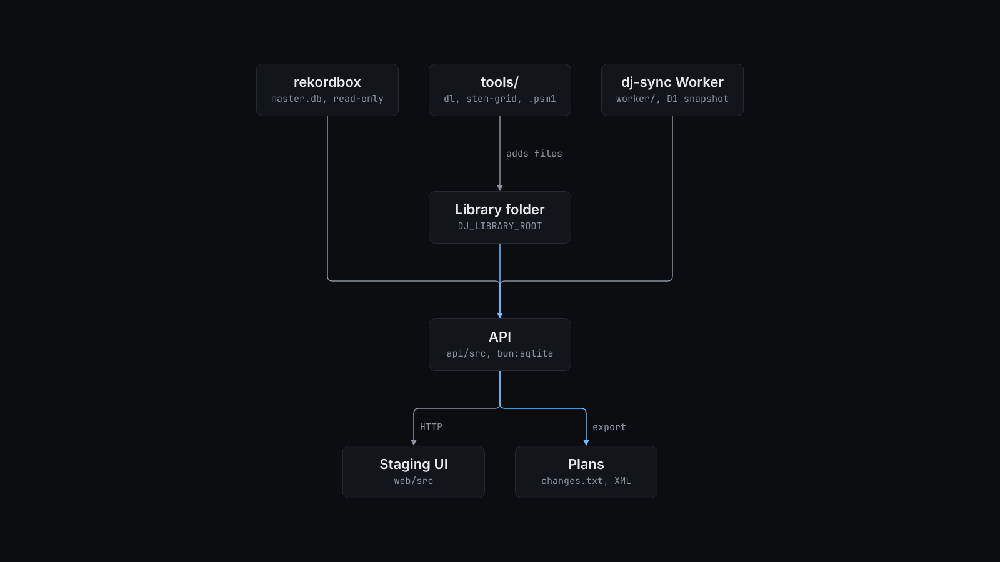

# How dj-organizer works

The API (`api/src`, Elysia on Bun) scans `DJ_LIBRARY_ROOT` and stores each track in `data/library.db` (`bun:sqlite`). A track's identity is an xxHash64 of its audio payload, so a renamed, moved or retagged file is still the same track. When there is no audio hash match, the API falls back to the source video id and then to a title and duration key. The duplicate finder (`dupes.ts`) groups tracks as `identical`, `source` or `twin`. It keeps one track per group and stages the rest.

rekordbox is a second store. The API reads `master.db` read-only and compares it with the folder on disk. Every playlist, membership and delete you make in the UI goes into an append-only operation log (`ops.ts`). The log replays as a plan per store:

- `GET /api/changes.txt` is the changeset against the latest rekordbox observation.
- `GET /api/plan/fs/text` is the filesystem plan.
- `GET /api/export/rekordbox.xml` is a rekordbox XML file that you import from rekordbox.

The **Apply** button (`POST /api/apply/rekordbox`) is the one path that writes to rekordbox. It closes rekordbox and runs `scripts/apply-rekordbox.py`. The script copies `master.db` to `DJ_BACKUP_DIR`, adds the pending tracks and playlist links, checks the result and reopens rekordbox. It calls `tasklist.exe` and `taskkill.exe`, so it works only on Windows or WSL.

Downloads (`download.ts`) are the only other writer. They call `yt-dlp --no-overwrites` and only add new files under the library folder. Snapshots of the staging database go to `data/snapshots/`.

The optional `worker/` is a Cloudflare Worker named dj-sync. A cron every 10 minutes refreshes your linked YouTube Music playlists into D1. `POST /api/ytm/pull` then reads one snapshot from the Worker instead of scraping YouTube from your machine. To deploy it, create the database with `wrangler d1 create dj-sync`, put its id into `worker/wrangler.jsonc`, load `worker/schema.sql`, and set the `SYNC_TOKEN` secret.
